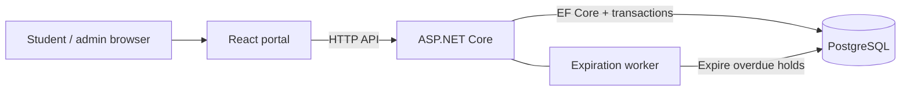
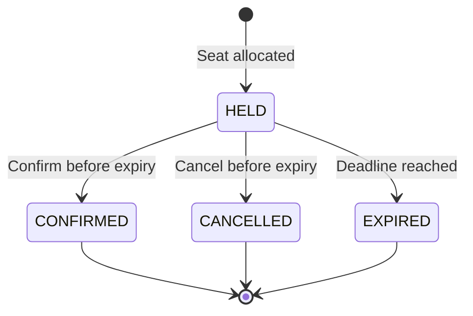

# School Admission System

A school admission portal where students reserve a seat, confirm it before the timer ends, and return later to see their applications. Administrators create admission classes and review applications from a protected panel.

**React 19 · TypeScript · ASP.NET Core 10 · EF Core · PostgreSQL 18 · Docker Compose**

[Quick start](#quick-start) · [Using the portal](#using-the-portal) · [How it works](#how-it-works) · [Development](#development) · [Tests](#tests) · [Documentation](#documentation)

## Quick start

Install Docker with Compose, then run these commands from the repository root:

```powershell
Copy-Item .env.example .env
```

If you already have a `.env`, keep it. Set these values in that file:

| Setting | What to enter |
| --- | --- |
| `POSTGRES_PASSWORD` | Your local database password |
| `Admin__AccessKey` | A private admin code of at least 32 characters |

```powershell
docker compose up --build --wait --wait-timeout 120
```

| Open | Address |
| --- | --- |
| Student and admin portal | [localhost:5173](http://localhost:5173) |
| API | [localhost:8080](http://localhost:8080/classes) |

Compose starts PostgreSQL, applies migrations, checks the API, then starts the frontend. The `migrator` container exiting with code **0** means it finished successfully. After the initial build, `docker compose up` starts the existing images; use `--build` after source changes.

Stop with `docker compose down`. The named database volume keeps classes and applications for the next start. See [container setup](docs/CONTAINERS.md) for configuration and the verified recreation test.

## Using the portal

| Student | Administrator |
| --- | --- |
| Enter a 17-digit birth registration number. | Click **Admin** and enter your admin code. |
| Search classes by name/shift and filter by availability. | Create a class with its name and seat capacity. |
| Apply to reserve a seat for 10 minutes by default. | Review applications with class/status filters and pagination. |
| Confirm with simulated payment, or cancel to release the seat. | Close the panel to end access. Reloading also clears the code. |
| Reopen the portal to restore your identity and fetch application history. | The API checks the admin credential on every protected request. |

Seat counts refresh quietly. The countdown uses database time; the backend makes the final expiry decision. **Change student** and **Forget this device** clear the saved identity and application view. Use synthetic student identifiers when trying the demo.

## How it works



A hold moves through one of these paths:



Allocation locks the class row in PostgreSQL before checking capacity and duplicates. Requests from different API processes therefore share the same allocation lock. Occupied seats are unexpired holds plus confirmed admissions; expired/cancelled rows remain as history. Repeated confirmation and cancellation preserve their original result.

EF Core handles queries and writes. Small parameterized SQL statements provide PostgreSQL row locks, worker batching and fresh database time. [Architecture and transaction flow](docs/ARCHITECTURE.md) · [Database ERD and indexes](docs/DATABASE.md)

## Development

Requires .NET 10 SDK, PostgreSQL 18, and Node.js 22.12+. Create your local database/account, then run from the repository root:

```powershell
dotnet restore SchoolAdmission.slnx
dotnet tool restore
$env:ConnectionStrings__DefaultConnection = "Host=localhost;Port=5432;Database=school_admission;Username=school_admission;Password=replace-with-your-local-password"
$env:Admin__AccessKey = "replace-with-your-private-admin-code-at-least-32-characters"
dotnet ef database update --project Backend/SchoolAdmission.Api
dotnet run --project Backend/SchoolAdmission.Api --launch-profile http
```

In another terminal:

```powershell
cd Frontend
npm ci
npm run dev
```

Local .NET execution needs exported environment variables; it does not load `.env` automatically. Development API documentation is at [Swagger UI](http://localhost:8080/swagger/index.html). API startup does not apply migrations.

<details>
<summary><strong>Addresses and settings</strong></summary>

| Setting | Purpose |
| --- | --- |
| `API_BASE_URL` | Browser-facing API address for the frontend container |
| `Frontend/public/config.json` | API address for local Vite development |
| `FRONTEND_PORT` | Portal host port; default 5173 |
| `API_HTTP_PORT`, `FRONTEND_HTTP_PORT` | Internal listener ports; default 8080 |
| `FRONTEND_ORIGIN` | Compose CORS override; otherwise derived from the frontend port |
| `HOLD_DURATION_SECONDS` | Hold lifetime; default 600 seconds |
| `Expiration__IntervalMilliseconds`, `Expiration__BatchSize` | Worker interval and batch size; defaults 1000 ms and 100 rows |

Keep the admin code in private server configuration. Public `config.json` contains only the API address. For remaining settings and standalone image commands, see [.env.example](.env.example), [frontend setup](Frontend/README.md) and [container setup](docs/CONTAINERS.md).

</details>

## Tests

Use a separate PostgreSQL account with `CREATE DATABASE` permission. Fixtures create and remove their own databases.

```powershell
$env:SCHEMA_TEST_CONNECTION_STRING = "Host=localhost;Port=5432;Database=postgres;Username=schema_test;Password=replace-with-your-test-password"
dotnet test SchoolAdmission.slnx --configuration Release
```

Without that variable, database cases are skipped. In `Frontend`, run `npm test`, `npm run lint` and `npm run build`.

**Recorded local results — 11 November 2026:**

| Check | Observed result |
| --- | --- |
| Earlier complete backend run | 248 passed, no skips |
| Latest focused backend run | 35 passed, no skips, including admin register and two-process allocation |
| Frontend | 120 tests passed; lint and production build passed |
| Two API processes, 100 requests, 10 empty seats | 10 accepted, 90 conflicts |
| Same burst with 3 held + 2 confirmed seats | 5 accepted, 95 conflicts; final occupancy 10 |
| Compose recreation | Class/application data survived container replacement |

The backend now contains 256 cases; the complete expanded suite has not been rerun locally. [Concurrency output](docs/evidence/multi-instance-concurrency.txt), [container evidence](docs/CONTAINERS.md#clean-startup-and-volume-persistence) and [verification notes](docs/PROGRESS.md) record the scope of each run. Hosted CI, mobile viewport and full browser-process restart verification remain outstanding.

## Documentation

| Looking for | Read |
| --- | --- |
| API routes, headers, payloads and errors | [API reference](docs/API.md) |
| Components, locks and lifecycle | [Architecture](docs/ARCHITECTURE.md) |
| Tables, ERD, constraints and migrations | [Database](docs/DATABASE.md) |
| Browser setup and behavior | [Frontend guide](Frontend/README.md) |
| Test commands and coverage | [Backend tests](Backend/SchoolAdmission.Tests/README.md) · [Coverage](docs/TESTING.md) |
| Containers and CI | [Docker guide](docs/CONTAINERS.md) · [CI guide](docs/CI.md) |
| Design choices and AI assistance | [Assumptions](ASSUMPTIONS.md) · [AI usage](AI_USAGE.md) |

This demo uses a student header and a shared admin key rather than individual verified accounts. Hold status is public by UUID, and payment is simulated. The [assumptions](ASSUMPTIONS.md) explain these boundaries.
