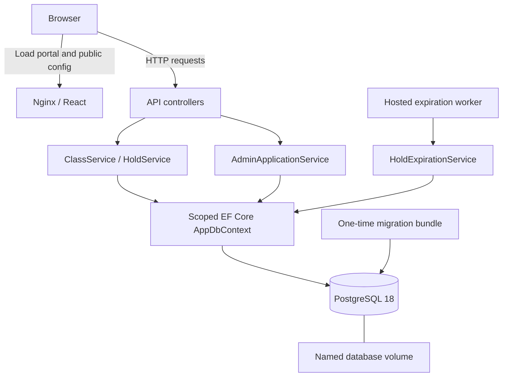
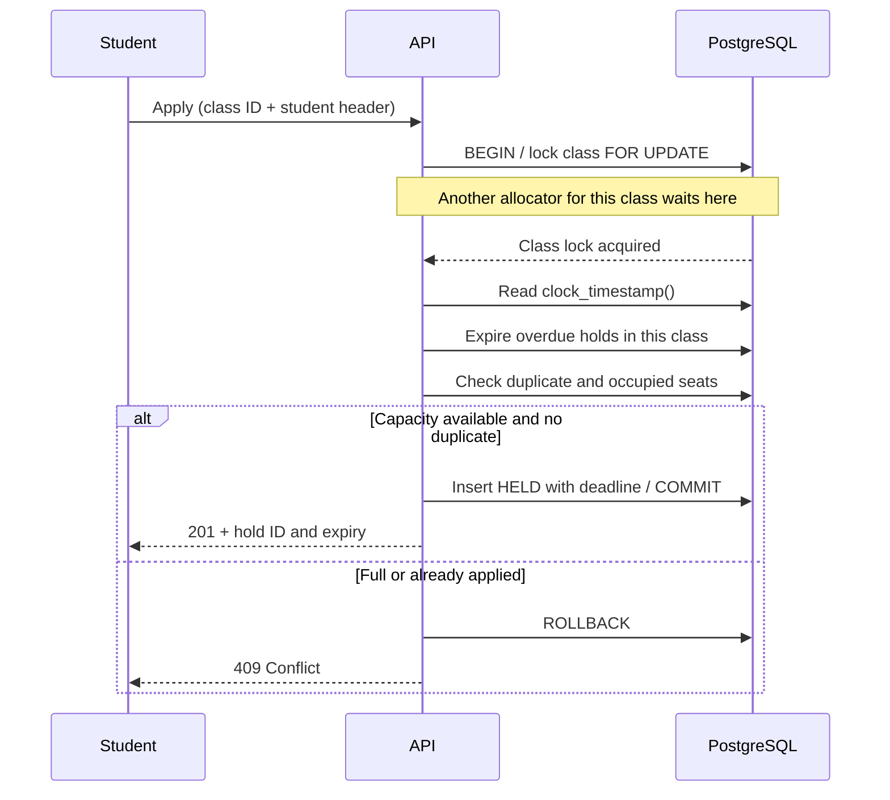

# Architecture

The portal is a React client talking directly to an ASP.NET Core API. PostgreSQL owns admission state and coordinates competing writes. There is no separate payment service or message broker.

## Components and startup

Compose waits for PostgreSQL health, runs the migration bundle, waits for database-backed API readiness, then starts the frontend. The API does not migrate on startup. Each worker cycle gets a fresh service scope. Ordinary container replacement preserves the named volume.

| Code | Responsibility |
| --- | --- |
| `Frontend/src/api/` | Runtime-configured requests, contracts, validation and safe errors |
| `Frontend/src/studentSession.ts` | Saved student selection and server-fetched history |
| `Frontend/src/classCatalog.ts`, `holdDetails.ts` | Catalog and detail state, polling and mutations |
| `Backend/SchoolAdmission.Api/Controllers/` | HTTP contracts, headers and response mapping |
| `Backend/SchoolAdmission.Api/Services/` | Allocation, summaries, admin application register, lifecycle and batch expiration |
| `Backend/SchoolAdmission.Api/Data/` | EF mappings, migrations and PostgreSQL constraints |
| `Backend/SchoolAdmission.Api/BackgroundServices/` | Scheduled expiration work |

Services use the scoped `AppDbContext` directly. The administrator service owns filter validation, effective expiry, ordering and pagination; its controller maps results to HTTP responses, while `AdminOnly` enforces access. EF Core handles normal reads and writes. Parameterized SQL is used where PostgreSQL-specific locking or wall-clock time is needed; there is no extra repository layer.

## Allocation transaction

The class lock coordinates allocation across processes, not just threads. A partial unique index also prevents duplicate `(class_id, student_id)` rows in HELD/CONFIRMED states. Capacity is counted from persisted applications rather than a separate seat counter.

Confirmation and cancellation lock the hold row, check ownership, then read fresh database time. An overdue hold is committed as EXPIRED before returning 409. Successful retries preserve the existing terminal result. The worker locks a bounded batch with `FOR UPDATE SKIP LOCKED`, rechecks status/time and expires only eligible rows.

Reads treat an overdue HELD row as effectively EXPIRED even before a worker cycle. The browser countdown is advisory; only a backend transaction can confirm an admission.

## Data and access

The [database ERD](DATABASE.md#database-model-and-migrations) describes the two domain tables, keys, timestamps and indexes. Student IDs remain strings so leading zeros and synthetic API identifiers are preserved. There is no separate student/account table.

Student identity uses `X-Student-Id`. Admin class creation, credential verification and the application register require `X-Admin-Key`. The admin code lives in server configuration and browser memory, while only the student ID is saved in localStorage. Public runtime configuration carries the API address only. Hold retrieval remains public by UUID, as required by the demo contract.

## Verification boundaries

Two separate API processes sharing PostgreSQL passed both empty and partially occupied 100-request allocation bursts. Both processes were observed waiting on database locks before release. [Recorded output](evidence/multi-instance-concurrency.txt) shows exact response and occupancy counts. This establishes shared-database allocation correctness on one machine; it does not measure network partitions or deployment throughput.

See [assumptions](../ASSUMPTIONS.md) for trade-offs, [API reference](API.md) for contracts, and [test coverage](TESTING.md) for expiry, rollback and restart checks.
