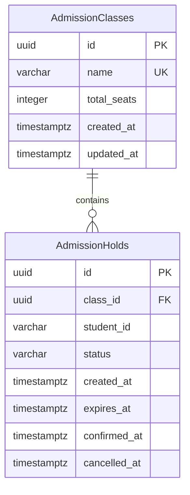

# Database model and migrations

Step 3 implements two domain tables, matching the revised plan's ERD. EF Core also maintains its own `__EFMigrationsHistory` metadata table.



## Mapping decisions

| Field | Storage and behavior |
| --- | --- |
| Both primary keys | UUID; generated by `Guid.NewGuid()` when constructing an entity |
| Class name | Required `VARCHAR(200)`, unique using PostgreSQL's default case-sensitive comparison |
| Total seats | Required integer with a `total_seats > 0` check |
| Student ID | Required `VARCHAR(64)`; preserves leading zeros and case; no numeric conversion or database 17-digit restriction |
| Status | Required `VARCHAR(16)`; enum conversion preserves `HELD`, `CONFIRMED`, `EXPIRED`, `CANCELLED`; a check rejects other stored values |
| Created/updated timestamps | `TIMESTAMPTZ`; PostgreSQL `clock_timestamp()` supplies insert defaults |
| Expiry timestamp | Required `TIMESTAMPTZ`; the hold service will assign it from database time in step 7 |
| Confirmed/cancelled timestamps | Nullable `TIMESTAMPTZ`; lifecycle services will populate them on transition |
| Relationship | Required class foreign key; deleting a class with application history is restricted |

The EF entities use UTC `DateTime` values. `updated_at` has an insert default, not an automatic update trigger; a future class-update operation must assign its update timestamp explicitly. There is no class-update endpoint in the current plan. Historical expiry timestamps remain populated after terminal transitions.

Database names are exactly `"AdmissionClasses"` and `"AdmissionHolds"`, with snake_case columns. PostgreSQL SQL must quote these mixed-case table names.

## Indexes

| Index | Columns / condition |
| --- | --- |
| `ux_admission_classes_name` | Unique `name` |
| `ix_admission_holds_class_status_expiry` | `(class_id, status, expires_at)` |
| `ix_admission_holds_student_created` | `(student_id, created_at)` |
| `ux_admission_holds_class_student_active` | Unique `(class_id, student_id)` where `status IN ('HELD', 'CONFIRMED')` |

The partial index intentionally uses status alone. An overdue row still stored as `HELD` occupies that index until it is persisted as `EXPIRED`. Step 7 must expire overdue rows inside the allocation transaction before checking for a duplicate and inserting. The database does not keep independent held/confirmed seat counters. Capacity protection across different students will come from the PostgreSQL row-locking transaction in step 7.

## Migration commands

The repository pins `dotnet-ef` to 10.0.8, matching EF Core. Run these commands from the repository root:

```powershell
dotnet tool restore
dotnet restore SchoolAdmission.slnx
$env:ConnectionStrings__DefaultConnection = "Host=localhost;Port=5432;Database=school_admission;Username=school_admission;Password=replace-with-your-local-password"
dotnet ef database update --project Backend/SchoolAdmission.Api
```

This explicitly applies `20261108192613_InitialAdmissionSchema`. Starting the API does not automatically apply migrations. Controlled Docker initialization is scheduled for packaging.

Check the model snapshot and generate a reviewable, idempotent SQL script:

```powershell
dotnet ef migrations has-pending-model-changes --project Backend/SchoolAdmission.Api
dotnet ef migrations script --idempotent --project Backend/SchoolAdmission.Api --output Backend/SchoolAdmission.Api/obj/schema.sql
```

Connection configuration is required for design-time DI, but generating the SQL script and comparing the model snapshot do not open a database connection.

## Real PostgreSQL schema checks

Schema tests use a PostgreSQL account with `CREATE DATABASE` permission. Each test fixture creates a uniquely named `school_admission_schema_<uuid>` database, applies the actual migration, and drops only that database during cleanup. The rollback/reapply test runs inside that owned database. Configure a test server account separately from application credentials:

```powershell
$env:SCHEMA_TEST_CONNECTION_STRING = "Host=localhost;Port=5432;Database=postgres;Username=schema_test;Password=replace-with-your-test-password"
dotnet test SchoolAdmission.slnx --configuration Release
```

With the variable absent, database-backed tests are explicitly skipped and foundation tests still run. GitHub Actions supplies an isolated PostgreSQL 18 service and this variable, so its backend job runs foundation, schema, and class API cases plus the model-snapshot check.

Verified locally against PostgreSQL 18 on 9 November 2026: **32 passed, zero failed, zero skipped** (21 foundation cases and 11 real schema cases). Schema checks cover the 13 domain columns/types/nullability, UUID mappings, leading-zero and maximum-length IDs, UTC timestamps, indexes, positive capacity, unique class names, foreign keys/restricted deletion, allowed statuses, active/confirmed uniqueness, historical reapplication, overdue-index cleanup, and migration rollback/reapply. These checks do not yet test admission endpoints or concurrent seat allocation.

The schema fixture was run in a temporary local Docker PostgreSQL container. Test output was saved locally to `Backend/SchoolAdmission.Tests/TestResults/step3-schema.trx` (ignored by Git).

Step 5 also uses this fixture for class HTTP tests, with a separate owned database per test class. The class cases verify response contracts, validation/errors, duplicate-name races, and counts from mixed application statuses. The step 5 run passed **55 cases** (21 foundation, 11 schema, 23 class API), with zero failures or skips. Results were saved to `Backend/SchoolAdmission.Tests/TestResults/step5-classes.trx`. The duplicate-name test is not a seat-allocation concurrency test.

Step 6 adds 17 seat-summary query cases using the same fixture. All **72 cases** passed on PostgreSQL 18 with zero failures or skips; results are in `Backend/SchoolAdmission.Tests/TestResults/step6-summaries.trx`. The exact expiry-boundary tests pin only the query's clock input; a separate test uses the live database clock inside an existing transaction. No schema changes or new migration were needed.
