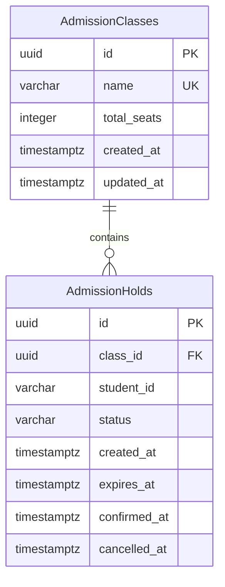

# Database model and migrations

The database contains two domain tables. EF Core also maintains its own `__EFMigrationsHistory` metadata table.



## Mapping decisions

| Field | Storage and behavior |
| --- | --- |
| Both primary keys | UUID; generated by `Guid.NewGuid()` when constructing an entity |
| Class name | Required `VARCHAR(200)`, unique using PostgreSQL's default case-sensitive comparison |
| Total seats | Required integer with a `total_seats > 0` check |
| Student ID | Required `VARCHAR(64)`; preserves leading zeros and case; no numeric conversion or database 17-digit restriction |
| Status | Required `VARCHAR(16)`; enum conversion preserves `HELD`, `CONFIRMED`, `EXPIRED`, `CANCELLED`; a check rejects other stored values |
| Created/updated timestamps | `TIMESTAMPTZ`; PostgreSQL `clock_timestamp()` supplies insert defaults |
| Expiry timestamp | Required `TIMESTAMPTZ`; the hold service assigns it from database time captured after acquiring the class lock |
| Confirmed/cancelled timestamps | Nullable `TIMESTAMPTZ`; lifecycle services will populate them on transition |
| Relationship | Required class foreign key; deleting a class with application history is restricted |

The EF entities use UTC `DateTime` values. `updated_at` has an insert default, not an automatic update trigger; a future class-update operation must assign its update timestamp explicitly. There is no class-update endpoint. Historical expiry timestamps remain populated after terminal transitions.

Database names are exactly `"AdmissionClasses"` and `"AdmissionHolds"`, with snake_case columns. PostgreSQL SQL must quote these mixed-case table names.

## Indexes

| Index | Columns / condition |
| --- | --- |
| `ux_admission_classes_name` | Unique `name` |
| `ix_admission_holds_class_status_expiry` | `(class_id, status, expires_at)` |
| `ix_admission_holds_student_created` | `(student_id, created_at)` |
| `ux_admission_holds_class_student_active` | Unique `(class_id, student_id)` where `status IN ('HELD', 'CONFIRMED')` |

The partial index intentionally uses status alone. An overdue row still stored as `HELD` occupies that index until it is persisted as `EXPIRED`. Hold creation expires overdue rows inside the allocation transaction before checking for a duplicate and inserting. The database does not keep independent held/confirmed seat counters. A PostgreSQL class-row lock serializes allocation across students and API instances.

## Migration commands

The repository pins `dotnet-ef` to 10.0.8, matching EF Core. Run these commands from the repository root:

```powershell
dotnet tool restore
dotnet restore SchoolAdmission.slnx
$env:ConnectionStrings__DefaultConnection = "Host=localhost;Port=5432;Database=school_admission;Username=school_admission;Password=replace-with-your-local-password"
dotnet ef database update --project Backend/SchoolAdmission.Api
```

This explicitly applies `20261108192613_InitialAdmissionSchema`. Starting the API does not automatically apply migrations. The backend image includes `/app/migrate` for controlled initialization before API startup; see [container setup](CONTAINERS.md).

Check the model snapshot and generate a reviewable, idempotent SQL script:

```powershell
dotnet ef migrations has-pending-model-changes --project Backend/SchoolAdmission.Api
dotnet ef migrations script --idempotent --project Backend/SchoolAdmission.Api --output Backend/SchoolAdmission.Api/obj/schema.sql
```

Connection configuration is required for design-time DI, but generating the SQL script and comparing the model snapshot do not open a database connection.

## Real PostgreSQL schema checks

Schema tests use a PostgreSQL account with `CREATE DATABASE` permission. Each test fixture creates a uniquely named `school_admission_schema_<uuid>` database, applies the actual migration, and drops only that database during cleanup. The rollback/reapply test runs inside that owned database. Configure a test server account separately from application credentials:

```powershell
$env:SCHEMA_TEST_CONNECTION_STRING = "Host=localhost;Port=5432;Database=postgres;Username=schema_test;Password=replace-with-your-test-password"
dotnet test SchoolAdmission.slnx --configuration Release
```

With the variable absent, database-backed tests are explicitly skipped and foundation tests still run. GitHub Actions supplies an isolated PostgreSQL 18 service and this variable, so its backend job runs the full suite plus the model-snapshot check.

Schema checks cover column types/nullability, UUID mappings, student-ID preservation, UTC timestamps, indexes, capacity constraints, foreign keys/restricted deletion, allowed statuses, active/confirmed uniqueness, historical reapplication, overdue-index cleanup, and migration rollback/reapply. API/query tests share the fixture, with a separate database per test class.

Concurrency tests queue requests behind a held class lock and inspect `pg_stat_activity`/`pg_blocking_pids` before releasing it. Two independent in-process API hosts compete for the last seat, and eight same-student requests exercise duplicate protection. Persisted occupancy is checked against capacity. Failed allocation rolls back its cleanup; successful allocation commits cleanup and the new row together.

Seat-summary and hold-retrieval tests check exact expiry boundaries using a fixed clock input and fresh wall-clock behavior using unmodified database queries. Retrieval reports an overdue HELD row as EXPIRED without persisting the transition; confirmed/cancelled statuses and historical timestamps remain unchanged. See [verification results](PROGRESS.md) and [test coverage](../Backend/SchoolAdmission.Tests/README.md).

The expiration service selects only a bounded set of overdue hold IDs with `FOR UPDATE SKIP LOCKED`. Within that transaction it reads fresh database time and uses an EF conditional update restricted to those IDs still marked HELD and overdue. Each hosted cycle resolves a fresh scoped service/DbContext. Concurrent workers skip busy rows; each batch commits separately. Only status changes, and worker logs contain counts or exception types without student identifiers.

Confirmation locks only the target hold row because it changes no class row or independent counter. Ownership is checked before mutation. Fresh post-lock database time decides whether to commit EXPIRED and return a conflict or to commit CONFIRMED with `confirmed_at`. Retrying an owned confirmation preserves the original timestamp. The same row lock coordinates with the expiration worker, while class summaries derive occupied capacity from statuses.

Cancellation uses the same hold-row locking order and ownership-first checks. A valid HELD row becomes CANCELLED with `cancelled_at`; an overdue one is committed as EXPIRED without a cancellation timestamp. Retry success preserves the existing CANCELLED row and its timestamps. No row is deleted, and the partial active-application index permits a new application once cancellation commits. Derived seat counts make the seat available without updating a separate counter.

Student application listing filters by the exact student identifier, joins the class name, and orders by creation time descending with UUID as a tie-breaker. A single query captures database time for effective expiry across all returned rows. It returns historical applications without tracking entities or persisting status changes. The `(student_id, created_at)` index supports the student/history access pattern.

Integration failure tests install temporary PostgreSQL triggers in fixture-owned databases to reject an allocation insert or lifecycle status update. Assertions verify transaction rollback, unchanged historical data, sanitized HTTP errors, and successful retries after removing the trigger. These objects are test-only and are not part of the application migration. See the [integration coverage matrix](TESTING.md).

Persistence tests terminate and restart the built API as separate OS processes against the same fixture database. They compare class/application identities and timestamps, verify retries and ownership checks after restart, and observe the worker releasing a hold that expired during downtime. PostgreSQL remains running throughout; database/container restart and named-volume persistence are separate deployment checks.
